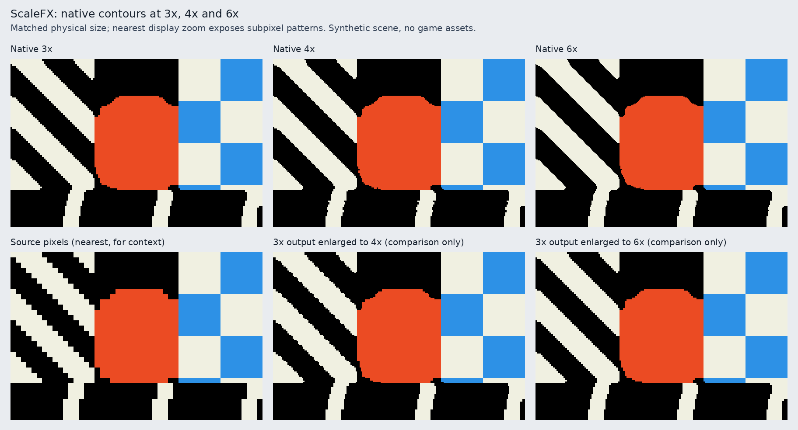

# ScaleFX native factors

`ScaleFX` supports 3x, 4x and 6x in Video Options and `config/video/scale`.
Unsupported configuration values default to 3x. UI layers using ScaleFX inherit
a supported main-window factor, otherwise 3x. Other scalers retain their existing
behaviour. The CPU implementation works with the existing SDL renderer and all
supported 16/32-bit surface layouts.

## Rendering

The original metric, corner-strength, junction and level-1-through-level-6 edge
analysis is shared by all factors. At 3x the original nine source selectors are
used unchanged; upstream GLSL fixtures and direct comparisons against the
previous CPU implementation must remain pixel-identical.

4x and 6x are **extensions** of ScaleFX, not additional modes of the original
3x shader. Detected edge levels supply horizontal/vertical contour normals.
Continuous half-planes are fitted between the positive corner/edge anchors and
negative anchors, including the pixel centre. Contradictory junctions fall back
to their local anchors. The contours are rasterized directly at the requested
4x4 or 6x6 sample centres using integer arithmetic and immutable pattern tables.
No 3x bitmap is built or magnified. Overlapping contours use their normalized
depth; ambiguous junctions preserve the source colour. Exact shared-edge ties
use a stable palette-index ordering so opposite sides of a diagonal agree.
Only original palette colours are written; no interpolated colours or blur are
introduced.

A per-window workspace retains metric/strength/flag buffers and lazily computed
palette-pair distances. RGB palette changes invalidate distances; source edge
flags are recomputed on each dirty update, preventing stale results after edits,
palette animation, surface swaps or resize. The source halo and repaint radius
remain six source pixels at all factors. Each source pixel's final edge analysis
runs once, with its results shared by all native output subpixels. Uniform
blocks bypass corner selection/raster tests when every possible source choice
has the same index. Warm calls make no scratch-buffer allocations.

## GPU investigation

The supported SDL3 3.2 renderer path in `imagewin.cc` uses `SDL_CreateRenderer`,
streaming `SDL_Texture`s, `SDL_LockTextureToSurface`, and CPU intermediate
surfaces. The 3.2 public renderer API has no custom shader/compute submission
hook. `SDL_PROP_RENDERER_GPU_DEVICE_POINTER` only exposes a device for the
SDL-GPU renderer backend; it neither works for all renderer backends nor exposes
a portable SDL_Renderer texture import/export and command synchronization path.
The documented native texture properties are backend-specific OpenGL/Vulkan/
Direct3D/Metal handles, not a portable SDL_GPUTexture bridge.

A separate SDL_GPUDevice can run custom compute/render pipelines, but integrating
its output here requires either:

- GPU readback to the CPU surfaces followed by another SDL texture upload,
  adding synchronization and transfers to every update; or
- changing renderer ownership/backend requirements, texture lifecycle, layer
  composition, readback/screenshot handling and cross-backend synchronization.

Neither is a practical acceleration of this change without disrupting the
existing renderer. No experimental GPU path is enabled, and no GPU speedup is
claimed. CPU rendering remains available everywhere. A future GPU backend
should own the source/palette textures and all ScaleFX passes, integrate dirty
uploads and palette generations, and hand the output directly to composition;
it needs a renderer-wide design and backend-specific performance validation.

The local evidence is SDL 3.2.10's `SDL_render.h` renderer/texture properties and
`SDL_gpu.h`, alongside Exult's surface/texture ownership and layer scaling
paths. The repository's Linux CI also targets the SDL 3.2 series. Newer SDL API
capabilities alone would not cover existing supported runtimes/backends.

## Validation and comparison

See README.md for repeatable test, sanitizer and benchmark commands. The test
suite includes shader goldens, direct old/new 3x comparisons (optional baseline
header), all factors with padded 16/32-bit output, tiny surfaces, tiled/dirty
updates, palette invalidation/restoration, workspace reuse, and reflected/rotated
45-degree diagonals. The independent diagonal oracle is the straight half-pixel
offset contour. Native 4x/6x produce zero sample errors on that test; nearest
magnification of 3x has errors and produces different masks.

The benchmark reports inclusive CPU scaling times for a deterministic 320x200
synthetic scene, a 16x16 dirty rectangle, and palette changes. Nine samples of
three calls are measured after warm-up and the median is reported. Timings
exclude SDL uploads/composition, vsync and gameplay. They are not FPS claims.
The optional original baseline is compiled with the same toolchain/settings.
The visual gallery compares the native factors and nearest magnification of 3x
at an equal displayed size, exposing the finer 4x/6x diagonal steps and curve
contours. It uses synthetic imagery because licensed game data is not present.

## Measured example

GCC 14.2, `-O2`, x86-64 Intel Xeon Platinum 8573C, Linux cloud host.
These are single-threaded CPU-scaler medians on the synthetic scene above,
measured with no build or test processes running. Shared-host scheduling and
CPU frequency can still vary; these are representative measurements, not
gameplay or GPU benchmarks.

| Implementation | Factor | Full frame (ms) | 16x16 dirty (ms) | Palette change (ms) |
| --- | ---: | ---: | ---: | ---: |
| Optimized native | 3x | 6.42 | 0.044 | 7.30 |
| Optimized native | 4x | 11.01 | 0.052 | 9.65 |
| Optimized native | 6x | 12.28 | 0.059 | 12.53 |
| Previous CPU | 3x | 10.02 | 0.059 | 8.92 |

The optimized 3x case is about 36% faster in this full-frame scene; dirty updates
also improve. 4x/6x spend additional time emitting more samples and rasterizing
native contours, but share the same source-resolution edge passes. Palette
changes invalidate the distance cache and remain supported at every factor.

Native 3x is identical to the original output. The native 4x and 6x examples
differ from nearest magnification of 3x in 205/24,576 and 269/55,296 samples
respectively; differences are concentrated at contours, while flat areas and
straight orthogonal edges remain stable. These counts demonstrate different
patterns, not a perceptual-quality score. The gallery shows finer diagonals
and curve steps. The independent straight-diagonal test has zero native
4x/6x sample errors; enlarged 3x has nonzero errors.

The full Exult build and address/undefined-behaviour sanitizer suite passed.
Headless application startup loaded and persisted ScaleFX factors 3, 4 and 6;
an invalid factor 5 normalized to 3. Interactive gameplay was not validated: the
environment has no licensed game data or interactive display. The offscreen
backend retains the pre-existing SDL rectangle warnings also seen with HQ3x.
